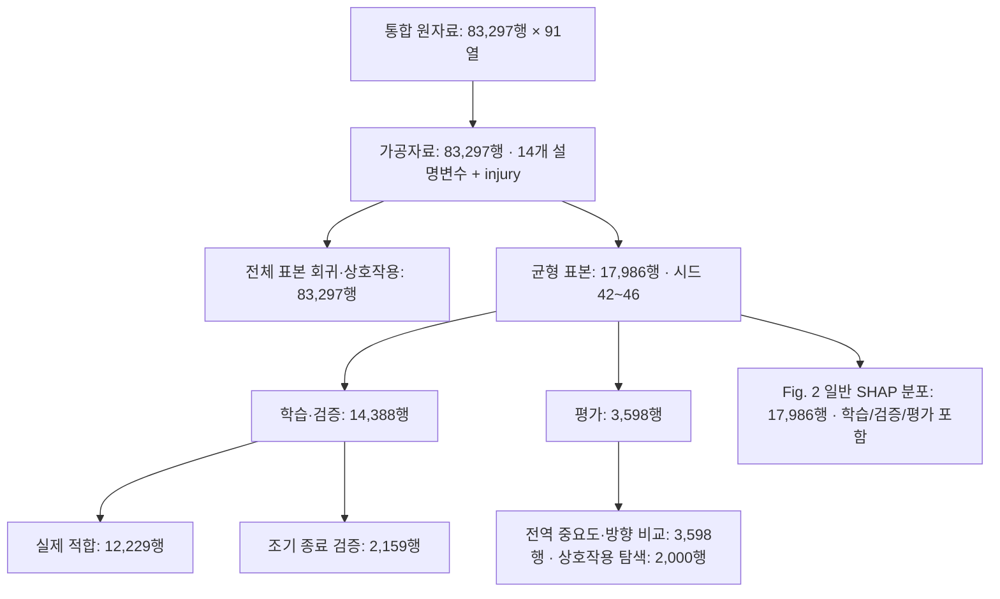

# 논문 분석 데이터 설명서

**기준일: 2026-11-02.** 이 문서는 원본 데이터 대신, 논문에 사용한 자료의 구성·전처리·분석 표본과 저장 결과의 관계를 설명한다.
현재 `src/01~08` 코드·`outputs/`·로컬 집계와 [교수 메모 반영 HWPX](paper/revisions/2026-11-02/APTE_교수메모반영_변경내용추적.hwpx)를 기준으로 정정하였다.
과거 [HWPX v3](paper/manuscripts/APTE논문_v3.hwpx)와 [전체 원고](paper/manuscripts/APTE_논문_전체원고_v1.md)는 당시 문안으로 보존한다.
개별 사고 기록은 싣지 않았고 분석 코드·자료·기존 산출물도 변경하지 않았다.
2026-11-02에는 같은 코딩으로 기존 LR·포아송·고정 α NB·단일 상호작용 결과를 재적합하여 검증하였다.
XGBoost·SMOTEN 재학습과 SHAP 전체 재계산을 완료했다는 뜻은 아니다.
[수정 검토 보고서](paper/revisions/2026-11-02/수정검토보고서.md)와 [추가 확인사항](paper/revisions/2026-11-02/데이터_분석_추가확인사항.md)에 확인 범위를 구분하였다.

## 1. 어떤 데이터로 무엇을 분석했는가

| 항목 | 논문·실제 분석 기준 |
|---|---|
| 연구 대상 | 기록된 고속도로 사고에서 인명피해가 발생했는지 여부 |
| 자료 범위 | 2011-01-01~2019-12-31, 전국 고속도로(논문 기재 범위) |
| 관측 단위 | 사고 기록 1행. 차량 1대나 피해자 1명을 1행으로 둔 자료가 아님 |
| 통합 원자료 | 83,297행 × 91열 |
| 최종 가공자료 | 83,297행 × 15열: 범주형 설명변수 14개 + 이진 종속변수 `injury` |
| 인명피해 발생 | 8,993건, 전체의 10.80% |
| 인명피해 없음 | 74,304건, 전체의 89.20% |
| 주 예측모형의 균형 표본 | 반복마다 17,986건: 인명피해 8,993건 + 인명피해 없음 8,993건 |
| 데이터 공개 범위 | 설명·집계 수치·변수 정의만 공개. 원자료와 행 단위 가공·분할 데이터는 제외 |

이미 발생하여 기록된 사고 안에서 인명피해 여부를 분석한 자료다.
사고가 없었던 도로·시간대 표본이나 교통량 등 노출량은 결합하지 않았으므로,
이 결과를 전체 도로에서의 사고 발생 확률로 해석하지 않는다.

### 자료 출처와 실제 입력 파일

기존 초안은 자료를 **한국도로공사 고속도로 교통사고 자료**로 서술하였다.
다만 공식 제공 자료명·제공 URL·취득일·
제공 범위·재배포 조건을 확정할 수 있는 제공 문서는 현재 저장소에 없다.
이 정보는 확인된 것처럼 채워 넣지 않았다.

실제 전처리 입력은 [전처리 코드의 RAW 설정](../src/01_preprocess.py#L22)에 있는
다음 로컬 파일이다. 파일 경로를 적은 것이며, 해당 CSV를 공개한 것은 아니다.

```text
APTE_교통사고_데이터/DATA/2011~2019_고속도로 교통사고 데이터/
└── 2011~2019 교통사고 통합 데이터.csv
```

전처리 결과는 로컬 `data/processed/analysis_dataset.csv`에 저장된다.
별도로 보관된 `data/raw/5차 전처리 데이터(1).csv`는 위 파이프라인의 직접 입력 파일이 아니다.
[과거 포스터 프로젝트](../projects/traffic-accident-poster/README.md)는 별도 분석 버전이므로
그 프로젝트의 변수 수·성능을 이 논문의 결과에 섞지 않는다.

### 연도별 기록 수

| 연도 | 사고 기록 수 |
|---|---|
| 2011 | 9,813건 |
| 2012 | 10,358건 |
| 2013 | 9,703건 |
| 2014 | 9,900건 |
| 2015 | 9,408건 |
| 2016 | 9,220건 |
| 2017 | 8,184건 |
| 2018 | 8,703건 |
| 2019 | 8,008건 |

합계는 **83,297건**이다. 원자료의 사고일자는 날짜 문자열 46,127건과 Excel 날짜 일련번호
37,170건이 섞여 있어, 이 표를 집계할 때 문자열 날짜와 일련번호를 나누어 해석했다.
일련번호는 `1899-12-30`을 기준으로 일 단위 변환했으며, 해석되지 않은 날짜는 0건이었다.
이는 설명서의 기간 확인용 집계이며 기존 전처리·모형을 변경한 것은 아니다.

## 2. 종속변수와 피해 구분

[타겟 생성 코드](../src/01_preprocess.py#L40)는 사망·중상·경상 열을 수치형으로 변환한 뒤
다음과 같이 이진값을 만든다. 변환되지 않는 값은 코드상 0으로 대치하지만,
확인한 통합 원자료에서는 세 피해 열의 빈 값이 없었다.

```text
사상자 수 = 사망 인원 + 중상 인원 + 경상 인원
injury = 1  if 사상자 수 > 0
injury = 0  otherwise
```

`injury=1`에는 사망사고도 포함된다. 따라서 이 문서에서는 변수명의 직역인
‘부상만 발생’ 대신 **인명피해 발생**으로 설명한다.

| 구분 | 조건 | 기록 수 | 전체 대비 |
|---|---|---|---|
| 인명피해 없음 | 사망·중상·경상 합계 = 0 | 74,304건 | 89.20% |
| 사망사고 | 사망 > 0 | 1,968건 | 2.36% |
| 중상사고 | 사망 = 0, 중상 > 0 | 1,635건 | 1.96% |
| 경상사고 | 사망 = 0, 중상 = 0, 경상 > 0 | 5,390건 | 6.47% |
| 인명피해 발생 합계 | 위 세 피해 사고 구분의 합 | 8,993건 | 10.80% |

사망·중상·경상 사고는 사고별 최고 심각도로 나눈 서로 겹치지 않는 구분이다.
인원수를 센 값과 사고 기록 수를 센 값을 구별해야 한다.
음이항 회귀의 종속변수는 위 이진값이 아니라 **사고당 사상자 수**이며,
확인한 자료에서 합계 14,239명, 사고당 0~26명이다.
가공자료의 `injury`는 통합 원자료에서 계산한 타겟과 83,297행 모두 일치한다.

## 3. 최종 14개 설명변수

모든 입력변수는 범주형이다. `원인차차종`은 승용·승합·화물 등의 차종,
`차종구분`은 원자료 `차종구분1`의 규모·세부 구분을 정리한 변수로 서로 다르다.
`연령구분`은 피해자의 나이가 아니라 **원인차 운전자 연령구분**에서 가져왔다.

| 분석 변수 | 원자료 열 | 현행 범주 수 | 가공자료의 범주 전체 |
|---|---|---|---|
| `주사고원인` | `주 사고원인` | 16 | `과속` · `주시태만` · `기타` · `졸음` · `노면잡물` · `타이어파손` · `단독차량화재` · `안전거리미확보` · `추월불량` · `도로사정` · `포트홀` · `적재불량` · `동물침입` · `차량기타` · `차량결함기타` · `-` |
| `교통장애요인` | `교통장애요인` | 4 | `장애없음` · `정차차량` · `정체` · `기타` |
| `발생지점` | `발생지점` | 6 | `본선` · `램프` · `영업소(TG)` · `터널` · `휴게소` · `기타` |
| `운전자상태` | `운전자상태` | 4 | `정상` · `피로` · `음주` · `기타` |
| `사고시도로환경` | `사고시도로환경` | 6 | `정상` · `미끄러운노면` · `낙하물` · `포트홀` · `기타` · `시거장애` |
| `원인차차종` | `원인차차종` | 6 | `승용` · `화물` · `트레일러` · `승합` · `특수` · `기타` |
| `날씨` | `날씨` | 5 | `맑음` · `비` · `흐림` · `눈` · `기타` |
| `조명시설` | `조명시설` | 4 | `해당없음(주간)` · `작동` · `없음` · `미작동` |
| `노면상태` | `노면상태` | 4 | `건조` · `습기` · `적설` · `기타` |
| `연령구분` | `원인차운전자연령구분` | 7 | `미상` · `40대` · `50대` · `30대` · `20대` · `60세이상` · `20세미만` |
| `사고직전차량조작` | `사고직전차량조작` | 4 | `운행차로주행` · `핸들과대조작` · `기타` · `차로변경` |
| `차종구분` | `차종구분1` | 9 | `중형` · `소형` · `대형` · `SUV형` · `미상` · `경형` · `일반화물` · `탑차` · `기타` |
| `절성토구분` | `절성토구분` | 7 | `평지` · `성토고 2M 이상 5M 미만` · `성토고 15M 이상` · `미상` · `절토부 10M 미만` · `절토부 10M 이상` · `성토고 2M 미만` |
| `평면선형` | `평면선형` | 4 | `직선` · `좌커브` · `우커브` · `미상` |

범주 수는 [최종 변수 요약표](../outputs/tables/final_variable_summary.csv)와 대조했고,
범주 전체 목록은 로컬 가공자료에서 확인했다. 기존 요약 CSV는 변수별 상위 12개 범주까지만
기록하므로, 범주가 16개인 `주사고원인`의 전체 목록은 이 표가 더 자세하다.

위 범주 수의 합은 **86개**다. 이는 14개 변수를 원-핫 인코딩했을 때의 열 수이며,
변수 자체가 86개라는 뜻은 아니다.
`절성토구분`의 저장 범주명 오류와 `주사고원인`의 `-` 값은 아래 검토사항을 함께 읽어야 한다.

## 4. 전처리와 변수 선정

처리 순서는 [전처리 코드](../src/01_preprocess.py)에 따른다.

1. **타겟 생성:** 사망·중상·경상 합계로 `injury`를 만든다.
2. **18개 후보 변수 구성:** 표기·범주를 정리한다. 사고유형·사고차량수·피해 규모·처리시간 등
   사고 결과 관련 열은 최종 입력으로 사용하지 않는다. 운전시간도 최종 입력에 포함되지 않는다.
3. **미상 처리:** 범주 정제 후 `미상` 비율이 0보다 크고 5% 미만이면 해당 변수 최빈값으로
   대치한다. 5% 이상이면 `미상`을 별도 범주로 유지한다.
4. **희소 범주 병합:** 전체 기록의 0.5% 미만인 범주를 `기타`로 합친다.
   `미상`은 이 병합에서 제외한다.
5. **공선성과 타겟 연관성 검토:** 조명시설과의 Cramér’s V가 0.7103인 `주야구분`을 제외한다.
   이후 미리 설정된 최종 변수 수 14개에 맞춰 타겟 연관성이 낮은 `주말여부`·`포장구분`·
   `성별`을 제외한다. 별도의 임의 V 절단값으로 하위 3개를 제거한 것은 아니다.
6. **가공자료 저장:** 행은 삭제하지 않고 최종 14개 변수와 `injury`를 저장한다.
   현재 가공자료에 빈 셀은 없지만, `미상` 등의 정보 부족 범주는 남아 있다.

최종 자료에서 `미상`을 유지하는 변수는 다음과 같다.

| 변수 | 가공자료의 미상 기록 | 전체 대비 |
|---|---|---|
| 연령구분 | 18,792건 | 22.56% |
| 차종구분 | 7,539건 | 9.05% |
| 절성토구분 | 8,233건 | 9.88% |
| 평면선형 | 4,457건 | 5.35% |

근거: [미상 처리 로그](../outputs/tables/missing_handling_log.csv),
[변수 선정 로그](../outputs/tables/variable_selection_log.csv),
[VIF 결과](../outputs/tables/vif_final.csv).
VIF는 최빈 기준범주를 뺀 72개 더미 기준이며 최대 5.464, 평균 약 1.480이다.
저장된 선정 로그에는 VIF 단계에서 추가로 제외된 변수가 없다.

## 5. 분석마다 사용한 표본과 인코딩



| 용도 | 표본 | 입력·처리 |
|---|---|---|
| XGBoost 주 설계 | 균형 17,986건을 반복 분할 | 인명피해 전부와 같은 수의 음성 기록을 무복원 추출, 86개 더미 |
| 실제 XGBoost 학습 | 반복당 12,229건 | 조기 종료용 검증 2,159건과 분리 |
| 주 설계 평가 | 반복당 3,598건 | 1:1 기저율, 분류 임계값 0.5 |
| 성능 비교용 로지스틱 | 대표 분할의 동일 학습·평가 기록 | 86개 더미, scikit-learn 기본 L2 규제 |
| Fig. 2 일반 SHAP 분포 | 대표 균형자료 17,986건 | 학습·검증·평가 관측치가 모두 포함됨 |
| 전역 중요도·방향 비교 | 대표 평가자료 3,598건 | 해당 범주가 30건 미만이면 방향값을 결측 처리 |
| SHAP 상호작용 탐색 | 대표 평가자료 중 2,000건 | 무작위 추출, 시드 42 |
| 오즈비·상호작용 회귀 | 원래 비율의 전체 83,297건 | 기준범주 14개와 완전분리 더미 1개를 뺀 71개 주효과 더미 + 절편; 상호작용 검정은 후보별 곱항 1개 추가 |
| 음이항 회귀 | 전체 83,297건 | 사고당 사상자 수, 71개 더미 + 절편 |
| TG 거리 보조 분석 | 별도 조건의 본선 사고 56,309건 | 통합 원자료의 노선명·이정·발생지점 사용 |

주 설계는 시드 **42~46**의 **반복 홀드아웃 평가**다. 5겹 교차검증이나
서로 독립된 다섯 개 원자료를 분석한 것이 아니다. 학습·평가를 먼저 80/20으로 나누고,
학습 부분의 15%를 다시 조기 종료 검증용으로 분리한다.
최대 600개 트리, 검증 AUC 기준 조기 종료 50회를 사용한다.

근거: [학습·분할 코드](../src/02_model_xgboost.py#L95),
[모형 설정](../outputs/model/model_config.json),
[SHAP 코드](../src/03_shap_analysis.py#L30),
[상호작용 코드](../src/05_interaction_deep.py).

## 6. 데이터와 논문 결과의 연결

### 주 예측 결과

[5회 요약표](../outputs/tables/model_balanced_summary.csv)의 수치는 다음과 같다.

| 지표 | 저장된 5회 평균 ± 표준편차 | 수정본 본문·표의 평균(소수 셋째 자리) |
|---|---|---|
| ROC-AUC | 0.7846 ± 0.0047 | 0.785 |
| AP (저장 열 이름: PR_AUC) | 0.7663 ± 0.0090 | 0.766 |
| F1-score | 0.7235 ± 0.0042 | 0.724 |
| Recall | 0.7622 ± 0.0078 | 0.762 |
| Precision | 0.6886 ± 0.0045 | 0.689 |
| Accuracy | 0.7087 ± 0.0041 | 0.709 |

`PR_AUC`라는 저장 열은 코드상 `average_precision_score`로 계산한 **Average Precision(AP)**이다.
최신 HWPX의 명칭은 AP로 정정하였으며 사다리꼴 적분 PR 면적과 구분한다.

[대표 분할 비교표](../outputs/tables/model_comparison.csv)의 seed 42 XGBoost는
ROC-AUC 0.7896, F1 0.7260, AP 0.7734다. 이는 위 5회 평균과 다른 요약이다.
원래 인명피해율은 10.80%지만 주 평가자료는 50:50이므로,
특히 Precision·AP를 실제 사고 분포에서의 운영 성능으로 그대로 옮겨 해석하지 않는다.

### 전체 표본 회귀와 상호작용

- [로지스틱 결과](../outputs/tables/logistic_or_table.csv)는 71개 더미의 오즈비를 저장한다.
  전체 표본을 사용하며, 균형 표본 17,986건만으로 추정한 표가 아니다.
- [음이항 결과](../outputs/tables/table_negbin_formatted.csv)는 같은 전체 표본에서
  사고당 사상자 수의 IRR을 저장한다.
- [SHAP–회귀 방향 비교](../outputs/tables/shap_lr_direction_agreement.csv)는
  방향을 비교할 수 있는 56개 더미 중 46개가 일치하여 82.1%다.
- [상호작용 결과](../outputs/tables/interaction_profile.csv)는 탐색한 24개 후보를
  전체 표본에서 점검하며, 후보집합 내 BH 보정 q<0.05인 쌍은 13개다.

### TG 거리 분석의 표본 차이

가공자료의 본선 57,381건 중에는 원자료에서 발생지점이 비어 있어 본선으로 대치된
563건이 포함된다. [거리 분석 코드](../src/08_tg_distance_gradient.py#L63)는
원자료에 본선으로 기록된 56,818건을 출발점으로 삼으며,
TG 위치를 추정할 수 없는 노선의 509건을 제외해 **56,309건**을 사용한다.
따라서 전체 본선 수와의 차이 1,072건을 모두 이정 결측으로 설명하면 안 된다.

이 표본의 인명피해는 7,472건(13.27%)이다.
TG 사고 이정의 0.7km 군집 간격과 최소 5건 기준으로 331개 위치를 추정하며,
46개는 물리 노선 수가 확정된 값이 아니라 코드가 묶은 노선명 그룹 수다.
거리는 같은 노선의 TG 추정 이정과 사고 이정의 절대차 최솟값으로,
실제 주행 경로나 진행방향을 반영한 이동거리가 아니다.
근거: [거리 구간별 집계표](../outputs/tables/tg_distance_gradient.csv).

## 7. 현재 데이터·결과를 해석할 때 남아 있는 검토사항

다음은 기존 자료·코딩의 상태다. 성토 명칭과 포트홀 해석은 최신 원고에서 정정했으며, 자료 자체의 재코딩·재학습은 수행하지 않았다.
기존 근거는 [2026-10-01 대조 검토](reviews/APTE_10_01_대조검토.md), 후속 확인은 [2026-11-02 검토](paper/revisions/2026-11-02/수정검토보고서.md)에 있다.

- **성토 범주명 오류:** 가공값 `성토고 15M 이상` 9,456건에는 원자료의
  `5M 이상 15M 미만` 8,164건과 `15M 이상` 1,292건이 함께 들어 있다.
  이를 실제 15m 이상 구간만의 관측값이라고 해석하면 안 된다.
- **포트홀 처리:** 주사고원인 포트홀 986건은 인명피해가 0건이다.
  회귀에서는 포트홀 더미 열만 빼고 986행은 남겨 전체 83,297행을 유지한다.
  따라서 주사고원인 기준효과를 과속만의 효과라고 설명할 수 없다.
- **미상 표기의 잔존:** `주사고원인`에는 `-` 465건이 별도 범주로 남아 있다.
  ‘모든 미상 표기를 완전히 정제했다’고 설명하지 않는다.
- **원자료 중복:** 전체 91개 열이 완전히 같은 추가 중복행이 3행 확인되었다.
  현재 파이프라인은 중복 제거 없이 83,297행을 사용한다. 이 행 수를
  중복이 제거된 고유 사고 수로 단정하지 않는다.
- **예측 평가의 범위:** 현재 전처리·타겟 연관성 기반 변수 선정은 전체 자료에서
  분할 전에 이루어진다. 보조 불균형 모형은 평가자료에서 F1이 최대인 임계값 0.61을
  고른다. 해당 저장 성능(F1 0.3520, ROC-AUC 0.7767)은 독립 검증 성능으로 보지 않는다.
- **탐색과 추정의 자료 중복:** SHAP 후보를 고른 평가 관측치가 전체 표본 회귀에도
  포함된다. 24개 후보 내 FDR 보정은 별도 독립 자료에서의 재현 검증을 뜻하지 않는다.

## 8. 확인한 파일 버전과 재현 범위

| 파일 | 역할 | GitHub 포함 여부 |
|---|---|---|
| `2011~2019 교통사고 통합 데이터.csv` | 주 전처리·사상자 수·TG 분석의 로컬 입력 | 제외 |
| `data/processed/analysis_dataset.csv` | 최종 14개 설명변수 + injury | 제외 |
| `outputs/model/`의 X/y 분할·SHAP 배열 | 학습·평가·SHAP의 행 단위 자료 | 제외 |
| `src/01~08` | 처리 규칙·분할·분석 구현 | 포함 |
| `outputs/tables/` | 집계 결과·모형 성능·계수·변수 목록 | 포함 |
| `outputs/model/model_config.json` | 주 모형 설정 | 포함 |
| 이 Markdown 문서 | 데이터의 범위·정의·논문 수치 대응 설명 | 포함 |

자료 버전을 구분할 수 있도록 확인한 로컬 파일의 SHA-256을 기록한다.
원자료 내용이나 개별 기록을 공개하는 값은 아니다.

```text
통합 원자료: 38ddf2800a35805894b79af4c57db217cc353bc4abb4151ef83e9ce888af256b
최종 가공자료: f76cec85b2e6b2f34402bf21aef9d12c86a430b545e0292b146cd364dca77b0b
```

이번 확인은 로컬 자료의 행·열 수, 타겟·범주·연도·피해 집계와 저장 결과표의 대조다.
전체 파이프라인의 재학습·재분석은 수행하지 않았다. 기존 코딩을 유지한 회귀 재적합 검증은 최신 보고서에 기록하였다. 데이터 파일이 제공되지 않으므로
GitHub의 코드와 집계표만으로 모든 분석을 완전히 재실행할 수는 없다.
공개·제외 파일의 전체 정리 기준은 [저장소 안내](repository_guide.md)를 참고한다.
